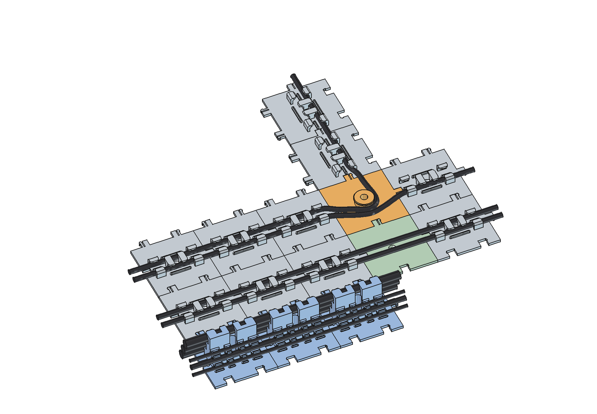
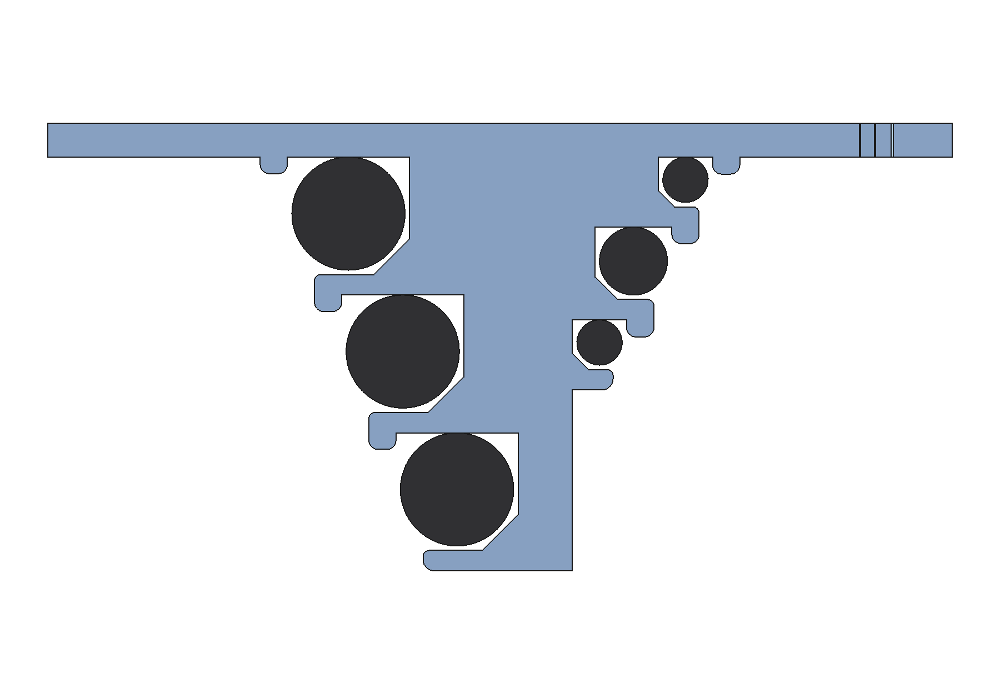

# kabelsalat

Parametric, 3D-printable cable management tiles for the underside of a desk, modelled in FreeCAD (Python).
The tiles snap together like a puzzle, each one is held by a single screw, and the cables click into hooks and
can be pulled out again. Every part has the same 72 × 72 mm footprint, so any tile connects to any other,
also rotated by 90°.

## Parts

| Part | What it does |
|------|--------------|
| **Kabelkachel** (flat tile) | Two cable lanes. Short hooks at the ends, a long hook from the other side in the middle, so the cable is held from both sides. |
| **Etagenkachel** (double/triple decker) | Two "trees" back to back on a solid keel, up to three cables stacked on each side. Every level has its own cable diameter. |
| **Kreisverkehr** (roundabout) | A post with a rim to lead cables around corners and into branches. |
| **Leerkachel** (blank tile) | Plain plate for crossings and gaps. |

The screw always sits in the middle of the tile. On the decker it goes through an 8 mm shaft in the keel.

## Printing

Ready-made STLs for 4, 6, 8 and 10 mm cables (flat, double and triple decker), plus roundabout and blank tile,
are in [`druck/v3`](druck/v3). The print guide with the full parts list, a test print and mounting notes is in
German: [`druck/v3/DRUCKEN.md`](druck/v3/DRUCKEN.md).

Short version:
- print as the STL comes, plate on the bed, **no supports**
- 0.2 mm layers, 3 walls, 15 % infill, PLA
- elephant-foot compensation 0.15 mm, otherwise the clips jam
- one 3.5 × 12 mm countersunk wood screw per tile, desk at least 15 mm thick

## Your own sizes

**Generator (Windows):** double-click `Kabel-Generator.bat`. It needs FreeCAD 1.1, nothing else. Choose the
part and the cable diameters, for a decker per side and per level. The window builds the part with the same
model, checks every level, writes the STL to `generiert/` and opens it in Bambu Studio.

**FreeCAD:** copy `kabelfuehrung.py` and `Kabelfuehrung.FCMacro` into the FreeCAD macro folder, open
`kabelfuehrung.FCStd` and change the values in the spreadsheet `Parameter`. All parts recompute. The most
useful ones:

| Parameter | Meaning |
|-----------|---------|
| `Kabeldurchmesser`, `Spuren` | cable diameter and lanes (1 or 2) of the flat tile; poller size of the roundabout |
| `A_Etagen`, `A_Kabel1..3` | decker, side A (the side with the pockets): number of levels 0–3, diameter per level from the desk outwards |
| `B_Etagen`, `B_Kabel1..3` | the same for side B (the side with the clips) |
| `Klemmung` | the click window is this much narrower than the cable (0.4 mm) |
| `PuzzleSpiel` | clearance of the snap clips per side (0.2 mm) |
| `Breite` | 72 mm. Changing it breaks compatibility with all other tiles. |

## How it works

- **Click fit:** between the hook lip and a low rail opposite it there is a window 0.4 mm narrower than the
  cable. The cable is pushed through it and stays in.
- **No supports:** the lip has a 45° wedge under it and only 3 to 5 mm of horizontal overhang.
- **Decker:** each level stands on the keel or on the lip of the level below, and the rail of the next level
  sits flush on that lip. Lower levels lie further out, so every cable can be clicked in from the side without
  another level in the way.
- **Snap clips:** a springy prong with a barb and a slit on +X and +Y, matching pockets on −X and −Y. Tiles
  are pressed together from the front (towards the desk).

`build.py` (run with `freecadcmd`) builds every part of the print set and checks it: the part is one valid
solid, the cable lies free in its channel and cannot be lifted straight out, the click window has the target
size, the insertion path of each level is free, and all connector pairings have 0.2 mm clearance and lock.
The results are in [`pruefbericht.txt`](pruefbericht.txt). `ansicht.sh` takes the screenshots in `bilder/` and
saves the FCStd.

## Status

The first version of the flat tile and the roundabout (6 mm) has been printed: clips and click fit work.
The 72 × 72 mm parts and the decker tiles of v3 have not been test-printed yet.

The design started from photos of modular snap-together cable guides and was then modelled from scratch and
extended (deckers, keel, generator). Built with [Claude Code](https://claude.com/claude-code).

## License

- Code (`*.py`, `*.pyw`, `*.bat`, `*.sh`, `*.FCMacro`): [MIT](LICENSE)
- Models (`*.FCStd`, `*.stl`): [CERN-OHL-P-2.0](LICENSES/CERN-OHL-P-2.0.txt)
- Documentation and images: [CC BY 4.0](LICENSES/CC-BY-4.0.txt)
